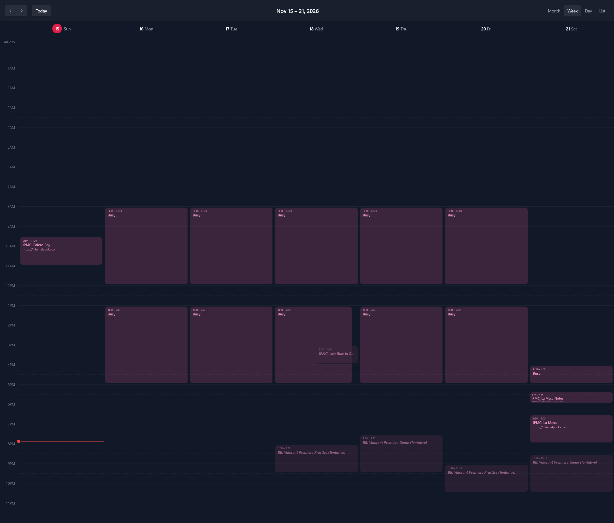

# Coffee Calendar

A simple, self-hosted way to share your calendar availability publicly in a browser, using any ICS/iCal link.



## What is Coffee Calendar?

Coffee Calendar is a simply safe, and a simply secure way to share your calendar, publicly, with people in a browser.

All you have to do is provide the app with an ICS link (Google Calendar, Outlook, iCloud, or anything else that gives you one), and it'll show, or won't show, people when you are busy. Private events just show up as "Busy", so nobody sees what you're actually doing.

It's great for letting absolutely anyone view when you're busy without giving them access to your actual calendar.

## Use Cases

* Sharing your calendar(s) securely.
* Combining calendars of multiple people into one, to see when everyone is free.
* Combining your own work and personal calendars, so people see when you're *actually* free.
* Letting clients see when you're booked as a freelancer or contractor, without showing who else you're working with.
* Letting students or clients check your availability before reaching out. (This one is mainly for tutors, coaches, consultants, etc)
* Manage when your entire family may be busy so you can plan family outings.
* Putting a "here's when I'm free" link in your email signature, LinkedIn, Discord, etc. (This is what I *personally* use it for)
* Sharing a read-only schedule for a club or small group, like meetups or office hours.
* Letting coworkers in other timezones see when you're busy without having to ask.

## Why not just give people my ICS link?

* I'm paranoid.
* Your ICS link gives away *everything* like event names, locations, descriptions, attendees, etc. Coffee Calendar only shows what you want people to see.
* ICS links are forever until they're revoked. You have to reset it for everyone if you want to revoke it.
* People can share your link with anyone and you won't know.
* Not everyone knows what to do with an ICS link. Everyone knows how to open a website.
* Your ICS link never leaves the server, so nobody visiting the page can see it.

## Features

* Read-only, public calendar view of your availability
* Works with any ICS/iCal feed
* Private events are shown as "Busy", with no details leaked
* Optionally hide "Free" events
* Self-hosted with Docker

## How do I use Coffee Calendar?

Just take a look at the [docker-compose.yml](./docker-compose.yml).

| Variable            | Description                                                               |
|---------------------|---------------------------------------------------------------------------|
| `CALENDAR_ICS_LINK` | A comma-separated list of the ICS links you want to show (required)       |
| `PUBLIC_URL`        | The public URL you're hosting it at (default: `http://localhost:3000`)    |
| `IGNORE_FREE`       | Set to `true` to hide "Free" events                                       |
| `TIMEZONE`          | Optional timezone (e.g. `America/Los_Angeles`) for the link preview image |

### Example

```yaml
services:
  coffee-calendar:
    image: beanbeanjuice/coffee-calendar:latest
    restart: unless-stopped
    ports:
      - "3000:3000"
    environment:
      PUBLIC_URL: https://busy.beanbeanjuice.dev
      CALENDAR_ICS_LINK: SOME_ICS_LINK_1,SOME_ICS_LINK_2,SOME_ICS_LINK_3
      IGNORE_FREE: true
```

## Future Plans

Right now, it's in a very rudimentary state, and I honestly don't plan to update it much further than this as I can't think of any other use cases. If you need something more complex, it might just be best to share your availability via the built-in features for Microsoft, Google, etc.

## AI Disclosure

I wrote basically all of this myself. I used AI for things like asking questions when I got stuck, or having it look over the code to check that things were working. Every line of code in this repo has been written or reviewed by me.

As an example, Claude helped me when NextJS was having difficulty compiling in Docker. It helped fix 1 line in my Dockerfile.

Claude also helped review the code as I am the only person currently working on this.
